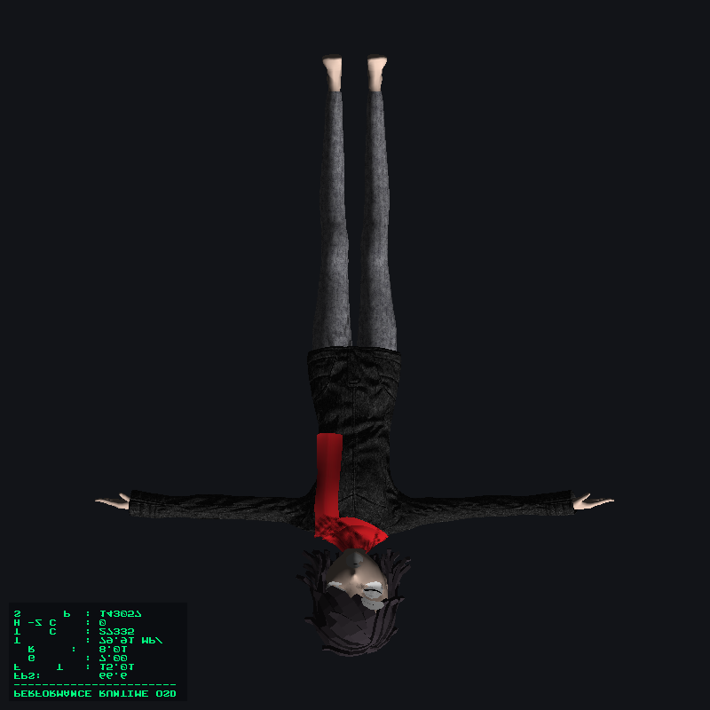

# cpugpurender

A software GPU written from scratch in C++20. It rasterizes textured, lit, shadowed 3D models entirely on the CPU, using multi-threaded tile rendering, AVX2 SIMD, and thread placement tuned for Intel hybrid (P-core / E-core) processors. A small Vulkan-style entry layer and a JIT shader compiler sit on top of the same backend.

This is the practical half of a two-year dissertation project on building a software GPU for hybrid CPUs. The long-term goal is to see how close a CPU can get to entry-level discrete GPU performance on compute-bound work.



## Features

**Rendering pipeline**
- Edge-function triangle rasterizer with barycentric interpolation of depth, UVs and normals
- Wavefront `.obj` loader with `.mtl` support (per-material diffuse textures, bump/normal maps, `Kd` fallback colors)
- Texture sampling via `stb_image` (TGA, PNG, JPG and others)
- Lambertian diffuse lighting plus an ambient term
- Tangent-space normal mapping
- Shadow mapping: orthographic light pass, lock-free parallel fill, slope-scaled bias, bilinear-filtered comparison
- 4x MSAA (rotated-grid sample pattern), toggleable at runtime

**Performance architecture**
- 32x32 tiled rendering with a dynamic work queue across all hardware threads
- Two-level triangle binning (coarse 4x4-tile regions, then per-tile bins), done in parallel, so each tile only tests triangles that touch it
- AVX2 + FMA SIMD path that shades 8 pixels at a time
- Early-Z rejection before shading
- Hierarchical-Z (Hi-Z) coarse culling per tile
- Hybrid-CPU topology detection (Windows `EfficiencyClass`): the main thread (geometry, UI) is pinned to P-cores and rasterizer workers are pinned to E-cores
- Built-in profiler and telemetry (geometry / rasterization / post-process time, triangles tested, early-Z rejections, Hi-Z culls, pixels shaded)
- Tile-size benchmark mode

**Frontends and tooling**
- Interactive Win32 viewport with an on-screen display (OSD) for live stats, drawn into the framebuffer with an embedded 8x8 bitmap font
- Headless mode that renders one frame and writes a PNG
- `vulkan_softgpu.dll`: a minimal Vulkan-style entry layer that forwards `vkQueueSubmit` to the renderer, plus a `vk_test` client that loads it dynamically
- JIT shader compiler: a small shader IR compiled to x86-64 machine code at runtime (see [JIT shader compiler](#jit-shader-compiler))

## Requirements

- **Windows 10/11, 64-bit.** The viewport, thread affinity, topology detection and JIT use Win32 APIs (`windows.h`, `SetThreadAffinityMask`, `VirtualAlloc`).
- **A CPU with AVX2 and FMA** (Intel Haswell / AMD Zen or newer). The build uses `-mavx2 -mfma` (`/arch:AVX2` on MSVC).
- **CMake 3.15+** and a **C++20 compiler** (developed with MSVC from Visual Studio).
- No other dependencies. `stb_image.h` and `stb_image_write.h` are bundled in `include/`.

The P/E-core split only applies on hybrid Intel CPUs. On other CPUs the renderer detects a standard topology and skips pinning.

## Build

From the repository root:

```powershell
cmake -B build -S .
cmake --build build --config Release
```

This produces three targets in `build/Release/`:

| Target | Output | Purpose |
|---|---|---|
| `cpugpurender` | `cpugpurender.exe` | The renderer (interactive viewport, headless mode, benchmarks) |
| `vulkan_softgpu` | `vulkan_softgpu.dll` | Vulkan-style entry layer over the same backend |
| `vk_test` | `vk_test.exe` | Test client that loads the DLL and submits a frame |

If `cmake` isn't on your PATH, use the one bundled with Visual Studio (under `Common7\IDE\CommonExtensions\Microsoft\CMake\CMake\bin`).

## Run

**Always run from the repository root.** Asset paths such as `assets/girl/girl OBJ.obj` are relative to the working directory.

```powershell
# Interactive viewport
.\build\Release\cpugpurender.exe

# Render a single frame to output_model.png and exit
.\build\Release\cpugpurender.exe --headless

# Benchmark 8x8, 16x16, 32x32 and 64x64 tile sizes
.\build\Release\cpugpurender.exe --bench-tiles

# Load the Vulkan-style DLL and render through it
.\build\Release\vk_test.exe
```

### Viewport controls

| Input | Action |
|---|---|
| Left mouse drag | Rotate the model |
| Arrow keys | Rotate in small steps |
| `M` | Toggle 4x MSAA |
| `Esc` | Quit |

The OSD in the top-left shows FPS, frame time, geometry and rasterization time, throughput (MP/s), triangles tested, Hi-Z culls, pixels shaded and MSAA state. The same numbers appear in the window title.

## How it works

Each frame runs in three stages.

1. **Shadow pass.** The model is transformed into light space and rasterized into a 1024x1024 depth map by multiple threads. Depth writes use a lock-free compare-and-swap "keep the minimum" update, so no locks are needed.
2. **Geometry pass.** Every triangle is rotated, projected to screen space and packed into a `RenderTask` that carries its UVs, normals, tangent, material textures, world-space positions (for shadow lookups) and the JIT shader pointer. This runs on the main thread, pinned to the P-cores.
3. **Tile rasterization.** `TileRenderer::renderParallel` bins the tasks into coarse regions and then into 32x32 tiles, and worker threads pinned to the E-cores pull tiles from a shared atomic counter. Each worker rasterizes only the triangles in its tile's bin: it applies the Hi-Z cull, runs the early depth test, then evaluates shadow, normal-mapped lighting and texture color (through the JIT shader when one is attached). With MSAA on, the samples are resolved into the color buffer at the end.

## JIT shader compiler

`src/shader_ir.h` defines a tiny instruction set (`MulF`, `AddF`, `SampleTex`, `DotV3`, `ClampF`). `src/jit_compiler.h` translates a `ShaderProgram` into x86-64 machine code at runtime, written into an executable page allocated with `VirtualAlloc`. The generated function has the signature `void(const PixelContext*, Color*)` and the rasterizer calls it per pixel.

Currently the JIT is a skeleton:

- The machine code is emitted by hand, with no LLVM or other backend.
- The arithmetic ops are emitted inline as scalar SSE instructions, while texture sampling, the normal-mapped dot product and the final color write call back into C++ helper functions.
- `main.cpp` compiles one fixed four-instruction program (sample, dot, multiply, clamp). There is no shader language or parser yet.

## Project structure

```
cpugpurender/
├── CMakeLists.txt
├── include/                 stb_image.h, stb_image_write.h (bundled, public domain)
├── assets/                  Test models and textures
│   ├── african_head.*       Classic tinyrenderer test model + diffuse map
│   └── girl/                Full-body model used by the viewport
├── src/
│   ├── main.cpp             Viewport, frame loop, OSD, headless + benchmark modes
│   ├── rasterizer.*         Scalar and AVX2 triangle rasterizers, MSAA, shadow lookup
│   ├── tile_renderer.*      Parallel binning, tile scheduling, Hi-Z culling
│   ├── framebuffer.*        Color/depth buffers, MSAA buffers, Hi-Z buffer, PNG output
│   ├── shadow_map.h         Lock-free shadow map with bilinear-filtered lookup
│   ├── model.*              OBJ + MTL loader
│   ├── texture.*            Texture loading and sampling
│   ├── hybrid_detector.*    P-core / E-core detection and affinity masks
│   ├── profiler.h           Per-stage timers and telemetry counters
│   ├── jit_compiler.*       x86-64 JIT for the shader IR
│   ├── shader_ir.h          Shader instruction set
│   ├── pixel_context.h      Per-pixel inputs passed to JIT shaders
│   ├── math_utils.h         Vec2 / Vec3
│   ├── math_matrix.h        Matrix4 (lookAt, ortho, transforms)
│   ├── font8x8.h            Embedded bitmap font for the OSD
│   ├── vulkan_entry.*       Vulkan-style entry points (built as vulkan_softgpu.dll)
│   └── vk_test.cpp          Client that loads the DLL dynamically
└── GPU Renderer Dissertation Roadmap.md
```

## Performance notes

All numbers below were measured on a 12th-gen Intel Core i5-1235U laptop (2 P-cores + 8 E-cores, 12 threads) at 800x800. They are development snapshots rather than a controlled benchmark, so expect different results on other hardware.

**Current build, full-body model, shadows and MSAA on.** The OSD in one development screenshot shows about 90–100 FPS (roughly 11 ms per frame, with about 8.7 ms in rasterization) at around 19% total CPU utilization.

**Earlier phase, African-head model (2,492 triangles), before shadows and MSAA.** Average rasterization time per tile size, before and after adding tile binning:

| Tile size | Before binning | After binning | Speedup |
|---|---|---|---|
| 8x8 | 159.19 ms | 6.57 ms | 24.2x |
| 16x16 | 40.18 ms | 4.59 ms | 8.7x |
| 32x32 | 13.79 ms | 3.91 ms | 3.5x |
| 64x64 | 5.72 ms | 3.24 ms | 1.7x |

Pinning rasterizer workers to the E-cores and geometry to the P-cores raised the same scene to around 200 FPS in the interactive viewport.

Run `--bench-tiles` to reproduce the tile-size comparison on your own machine.

## Known limitations

- **Windows only**, and the Win32 viewport, affinity API and JIT would need porting for other platforms.
- **MSAA and SIMD:** when MSAA is active, the SIMD rasterizer hands the work to the scalar tile path, which is the one with full MSAA support. MSAA is on by default, so press `M` to turn it off and exercise the AVX2 path.
- **Hi-Z culling** compares against the previous frame's per-tile depth, so it is a heuristic while the model is moving, not a guaranteed-conservative test.
- **Normal mapping** uses one tangent per face, so shading can look off on steep or degenerate UVs.
- **The Vulkan layer is a mock.** It exposes seven entry points (`vkCreateInstance`, `vkDestroyInstance`, `vkEnumeratePhysicalDevices`, `vkCreateDevice`, `vkDestroyDevice`, `vkGetDeviceQueue`, `vkQueueSubmit`). `vkQueueSubmit` ignores the submitted work and renders a fixed scene (the African head) to `output_vulkan.png`. It is not a conformant Vulkan driver.
- **Hardcoded model path:** the viewport loads `assets/girl/girl OBJ.obj`. To render a different model, change the path in `src/main.cpp` and rebuild. Scale and centering are computed automatically.
- Single directional light, no skeletal animation, no glTF/VRM support.

## Roadmap

Planned next steps from the dissertation roadmap:

- AVX-512 variant of the SIMD path, with runtime selection
- Moving from the hand-written JIT skeleton toward a real shader compiler backend
- A compute-bound benchmark (ray tracing) to compare against low-end discrete GPUs
- Further profiling and tuning of cache behavior and thread scheduling

## Credits

- `african_head.obj` and its diffuse texture come from Dmitry Sokolov's [tinyrenderer](https://github.com/ssloy/tinyrenderer) course, which this project's early stages followed.
- [`stb_image` and `stb_image_write`](https://github.com/nothings/stb) by Sean Barrett (public domain).
- 8x8 bitmap font data is a public-domain font embedded in `src/font8x8.h`.

## License

No license has been specified yet.
